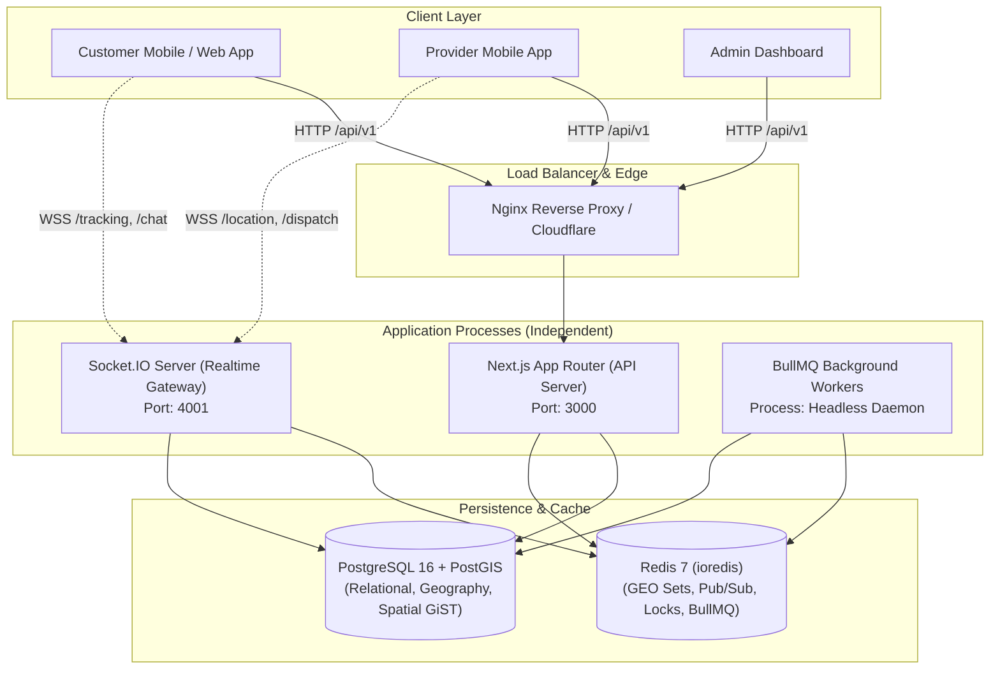

# NEEDS BACKEND — SYSTEM ARCHITECTURE DOCUMENTATION
**Document ID:** ARCH-001  
**Author:** Senior Backend Architect, Next.js Engineer, PostgreSQL/PostGIS Specialist, Redis & Security Engineer  
**Date:** November 9, 2026  
**Status:** PRODUCTION BASELINE ESTABLISHED  

---

## 1. System Overview & Vision

**Needs** is an on-demand service-booking platform connecting customers with vetted local service providers (AC Repair, Plumbing, Electrical, Home Cleaning, etc.) across Bangladesh.

To achieve high developer velocity, transactional reliability, spatial precision, and horizontal scalability, the backend is built as a **Modular Monolith using Next.js App Router (Node.js runtime)**, backed by **PostgreSQL 16 + PostGIS**, **Redis 7 (ioredis)**, **BullMQ**, and a decoupled **Socket.IO Realtime Gateway** with horizontal Redis adapters.

---

## 2. Process Decoupling Architecture

A common antipattern in Node.js architectures is combining high-frequency WebSockets, long-running job loops, and HTTP request routing into a single process or attempting to run stateful WebSockets in serverless functions. 

Needs Backend strictly isolates these into **three independently deployable persistent Node.js processes**:

| Process Component | Entrypoint | Runtime Environment | Primary Responsibility |
|---|---|---|---|
| **Next.js API Server** | `npm run start` (or `dev`) | Node.js Persistent Server (`port: 3000`) | Handles all `/api/v1/...` REST endpoints, Zod validation, JWT authentication, database transactions, and Swagger UI at `/api/docs`. |
| **Realtime Gateway** | `tsx src/realtime/server.ts` | Node.js Persistent Daemon (`port: 4001`) | High-frequency telemetry ingestion, customer tracking rooms, chat, scaled horizontally via `@socket.io/redis-adapter`. |
| **BullMQ Worker** | `tsx workers/index.ts` | Node.js Persistent Daemon | Background job processing: booking timeout, candidate dispatch rotation, payment verification, notification dispatch, and cleanup. |

---

## 3. Data Tier & Spatial Engine

### 3.1 PostgreSQL 16 + PostGIS
- **Prisma Client Singleton** (`src/database/prisma.ts`) manages normalized relational models, relations, transactions, and foreign keys.
- **PostGIS Engine** (`src/database/postgis.ts`) executes high-performance spatial queries directly against PostGIS geometry and geography columns (`ST_SetSRID(ST_MakePoint(lon, lat), 4326)`).
- **GiST Spatial Indexes**:
  - `idx_providers_spatial` on `providers(currentLongitude, currentLatitude)`
  - `idx_user_addresses_spatial` on `user_addresses(longitude, latitude)`
  - `idx_bookings_spatial` on `bookings(longitude, latitude)`

### 3.2 Redis (ioredis)
- **Redis GEO**: Real-time provider coordinates stored using `GEOADD geo:<city>:<categoryId> <lon> <lat> <providerId>` with rapid `GEOSEARCH ... BYRADIUS` queries for dispatch candidate discovery.
- **Redis Distributed Locks**: Atomic locks (`lock:<resource>`) via single-node Redlock pattern with NX/PX options and Lua script release, guarding concurrency gates such as dispatch acceptance and booking state transitions. PostgreSQL transactions and database unique constraints provide the final transactional consistency guarantee.
- **Redis Pub/Sub**: Inter-process and inter-socket synchronization across clustered instances.

---

## 4. BullMQ Background Task Queues

Seven foundational distributed queues are initialized in `src/infra/queue/queue.manager.ts`:

1. `booking-expiry`: Automatically expires unassigned bookings and triggers customer alerts.
2. `dispatch`: Handles 45-second provider response timeouts and auto-redispatch to candidate #2.
3. `notifications`: Asynchronous FCM push notification and SMS fallback delivery.
4. `payment-verification`: Background verification of pending payment sessions.
5. `payouts`: Processing provider balance withdrawal batches.
6. `analytics`: Offloading analytical event ingestion.
7. `cleanup`: Stale OTP and ephemeral session pruning.

---

## 5. Security & Authentication Model

- **Dual-Token Architecture**: 15-minute Access JWT, 7-day cryptographically secure Refresh Token with session rotation and family revocation on reuse.
- **Rate Limiting**: Redis sliding-window token bucket on sensitive endpoints (OTP send, verify, login).
- **Zero Hardcoded Credentials**: Strictly validated environment schema via Zod (`src/config/env.ts`), failing fast at boot.
- **Request ID Tracking**: Automated `x-request-id` propagation across all HTTP responses for auditability.

---

## 6. Microservice Extraction Roadmap

Every domain module under `src/modules/` is structured to allow straightforward extraction into a standalone microservice:
- Modules encapsulate their own controller, service, repository, DTOs, and types.
- Cross-module communication occurs strictly via public service interfaces or message queues, never through direct internal database mutations.
