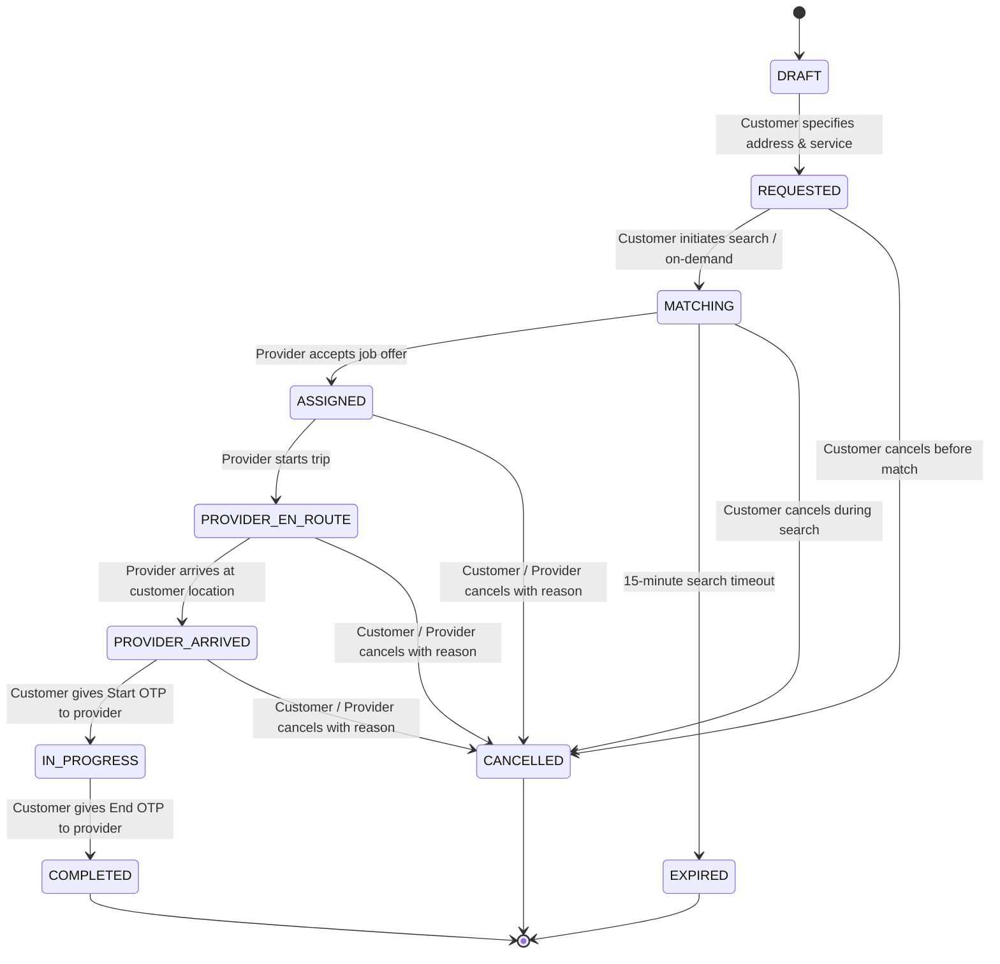

# Needs Backend — Booking State Machine & Immutable Ledger Specification
**Version:** 1.0.0  
**Phase:** 3  

---

## 1. Overview

The Booking State Machine enforces the complete service lifecycle defined in the Needs SRS (Appendix A). State transitions are atomic, strictly sequenced, and recorded in an append-only event ledger.

---

## 2. State Transition Graph (Appendix A)

---

## 3. State Invariants & Permissions

| Transition | Allowed Actor | Trigger Action | Required Validations |
|:---|:---|:---|:---|
| `DRAFT` $\to$ `REQUESTED` | Customer | Initial booking creation | Valid active service ID, Bangladesh coordinate bounds |
| `REQUESTED` $\to$ `MATCHING` | Customer / System | `action: "REQUEST"` | Customer ownership, triggers `dispatchBooking` |
| `MATCHING` $\to$ `ASSIGNED` | Provider | Dispatch acceptance | Acquired Redis lock, `status: PENDING` assignment |
| `ASSIGNED` $\to$ `PROVIDER_EN_ROUTE` | Assigned Provider | `action: "START_TRIP"` | `booking.providerId == providerId` |
| `PROVIDER_EN_ROUTE` $\to$ `PROVIDER_ARRIVED` | Assigned Provider | `action: "ARRIVE"` | `booking.providerId == providerId` |
| `PROVIDER_ARRIVED` $\to$ `IN_PROGRESS` | Assigned Provider | `action: "START_WORK"` | Exact match with customer's 4-digit `startOtp` |
| `IN_PROGRESS` $\to$ `COMPLETED` | Assigned Provider | `action: "COMPLETE_WORK"` | Exact match with customer's 4-digit `endOtp` |
| `*` $\to$ `CANCELLED` | Customer, Provider, Admin | `action: "CANCEL"` | Valid non-empty `cancellationReason` |
| `MATCHING` $\to$ `EXPIRED` | System Worker | 15-minute BullMQ job | Unassigned after max dispatch iterations |

---

## 4. Cryptographic Job OTP Protocol

To eliminate fraud, unauthorized job starts, and false completion claims:
1. **Generation:** When a booking is created, the system generates two distinct 4-digit cryptographic numeric codes:
   - `startOtp = crypto.randomInt(1000, 10000)`
   - `endOtp = crypto.randomInt(1000, 10000)`
2. **Customer View:** Both OTPs are immediately available to the customer upon booking query (`GET /api/v1/bookings/:id`).
3. **Provider View:** Both OTPs are **masked/removed** (`undefined`) from provider API responses until the provider reports arrival (`PROVIDER_ARRIVED`).
4. **Physical Verification Handshake:**
   - Provider arrives $\to$ Customer verbally gives `startOtp` $\to$ Provider submits via `PATCH /api/v1/bookings/:id/transition` with `{ "action": "START_WORK", "otp": "..." }`.
   - Work completes $\to$ Customer verbally gives `endOtp` $\to$ Provider submits with `{ "action": "COMPLETE_WORK", "otp": "..." }`.

---

## 5. Immutable Event Ledger (`booking_events`)

Every state transition executes inside an atomic `prisma.$transaction` that records an immutable `BookingEvent` entry.

### Schema Fields
- `id`: Unique UUIDv4.
- `bookingId`: Foreign key to `bookings` (`ON DELETE RESTRICT`).
- `fromStatus`: State prior to transition.
- `toStatus`: State after transition.
- `actorId`: ID of the initiating user or `"SYSTEM"`.
- `actorRole`: `CUSTOMER`, `PROVIDER`, `ADMIN`, or `SYSTEM`.
- `note`: Operational note or cancellation reason.
- `metadata`: JSON object containing transition details (`action`, timestamps, IP).
- `createdAt`: UTC timestamp of the change.

Deletion or mutation of historical `booking_events` rows is strictly prohibited by database constraint and application logic.
