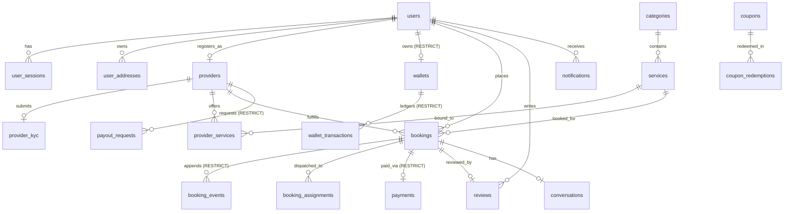

# NEEDS BACKEND — DATABASE SCHEMA SPECIFICATION
**Document ID:** DB-SCHEMA-001  
**Author:** PostgreSQL & PostGIS Specialist, Data Architect  
**Date:** November 9, 2026  
**Status:** MIGRATION VERIFIED (`20261109000000_init_postgis`)  

---

## 1. Schema Overview

The Needs platform database uses **PostgreSQL 16** with the **PostGIS** extension.
Primary keys are universally **UUID v4**, timestamps are stored in **UTC**, monetary values use **Decimal(12,2)** (avoiding floating-point representation), and geospatial coordinates are indexed with **GiST** on `::geography`.

Financial ledger records (`wallets`, `wallet_transactions`, `payout_requests`, `payments`) and lifecycle history (`booking_events`) enforce database-level `ON DELETE RESTRICT` constraints to prevent accidental or cascade deletion of audit trails and ledger integrity.



---

## 2. Table Catalog & Constraint Enforcements

### 2.1 Identity & Access Management

#### `users`
| Column | Type | Constraints | Description |
|---|---|---|---|
| `id` | TEXT / UUID | PRIMARY KEY | Unique user identifier |
| `phone` | TEXT | UNIQUE, NOT NULL | Primary login identifier (E.164) |
| `email` | TEXT | UNIQUE, NULLABLE | Optional contact email |
| `fullName` | TEXT | NULLABLE | User's full name |
| `avatarUrl` | TEXT | NULLABLE | Profile picture URL |
| `language` | TEXT | DEFAULT 'en' | Preferred UI language ('en', 'bn') |
| `role` | Role | DEFAULT 'CUSTOMER' | Enum: CUSTOMER, PROVIDER, ADMIN, etc. |
| `status` | AccountStatus| DEFAULT 'ACTIVE' | Enum: ACTIVE, SUSPENDED, DELETED |
| `createdAt` | TIMESTAMP(3)| DEFAULT CURRENT_TIMESTAMP | Record creation timestamp |
| `updatedAt` | TIMESTAMP(3)| AUTO UPDATE | Last update timestamp |
| `deletedAt` | TIMESTAMP(3)| NULLABLE | Soft delete timestamp |

#### `user_sessions`
| Column | Type | Constraints | Description |
|---|---|---|---|
| `id` | TEXT / UUID | PRIMARY KEY | Session identifier |
| `userId` | TEXT | FK -> users(id) ON DELETE CASCADE | Associated user |
| `refreshTokenHash` | TEXT | UNIQUE, NOT NULL | SHA-256 hash of rotating refresh token |
| `deviceInfo` | TEXT | NULLABLE | Hardware / Browser description |
| `ipAddress` | TEXT | NULLABLE | Client IP at login |
| `userAgent` | TEXT | NULLABLE | Client User-Agent string |
| `isValid` | BOOLEAN | DEFAULT true | Session revocation flag |
| `expiresAt` | TIMESTAMP(3)| NOT NULL | Expiration timestamp |
| `createdAt` | TIMESTAMP(3)| DEFAULT CURRENT_TIMESTAMP | Session start |
| `updatedAt` | TIMESTAMP(3)| AUTO UPDATE | Last update |

#### `user_addresses`
| Column | Type | Constraints | Description |
|---|---|---|---|
| `id` | TEXT / UUID | PRIMARY KEY | Address identifier |
| `userId` | TEXT | FK -> users(id) ON DELETE CASCADE | Associated user |
| `label` | TEXT | DEFAULT 'Home' | Address label ('Home', 'Work') |
| `addressLine` | TEXT | NOT NULL | Street address, house/flat number |
| `area` | TEXT | NOT NULL | Locality / Neighborhood |
| `city` | TEXT | NOT NULL | City / District |
| `postalCode` | TEXT | NULLABLE | Postal zip code |
| `latitude` | DOUBLE PRECISION | NOT NULL | GPS Latitude (-90 to 90) |
| `longitude` | DOUBLE PRECISION | NOT NULL | GPS Longitude (-180 to 180) |
| `isDefault` | BOOLEAN | DEFAULT false | Primary address flag |
| `createdAt` | TIMESTAMP(3)| DEFAULT CURRENT_TIMESTAMP | Creation timestamp |
| `updatedAt` | TIMESTAMP(3)| AUTO UPDATE | Last update timestamp |

---

### 2.2 Providers & KYC Verification

#### `providers`
| Column | Type | Constraints | Description |
|---|---|---|---|
| `id` | TEXT / UUID | PRIMARY KEY | Provider profile identifier |
| `userId` | TEXT | UNIQUE, FK -> users(id) ON DELETE CASCADE | User account |
| `bio` | TEXT | NULLABLE | Professional summary |
| `experienceYears`| INTEGER | DEFAULT 0 | Years in trade |
| `status` | ProviderStatus | DEFAULT 'PENDING' | Enum: PENDING, APPROVED, REJECTED, SUSPENDED |
| `isAvailable` | BOOLEAN | DEFAULT false | Online availability flag |
| `rating` | DECIMAL(3,2) | DEFAULT 5.00 | Aggregate rating (1.00 - 5.00) |
| `totalRatings` | INTEGER | DEFAULT 0 | Count of reviews received |
| `completedJobs` | INTEGER | DEFAULT 0 | Count of successfully finished jobs |
| `currentLatitude`| DOUBLE PRECISION | NULLABLE | Last reported GPS latitude |
| `currentLongitude`| DOUBLE PRECISION| NULLABLE | Last reported GPS longitude |
| `lastLocationUpdate`| TIMESTAMP(3)| NULLABLE | Timestamp of last telemetry |
| `createdAt` | TIMESTAMP(3)| DEFAULT CURRENT_TIMESTAMP | Creation timestamp |
| `updatedAt` | TIMESTAMP(3)| AUTO UPDATE | Last update timestamp |

#### `provider_kyc`
| Column | Type | Constraints | Description |
|---|---|---|---|
| `id` | TEXT / UUID | PRIMARY KEY | KYC record identifier |
| `providerId` | TEXT | UNIQUE, FK -> providers(id) ON DELETE CASCADE | Associated provider |
| `nidNumber` | TEXT | NOT NULL | National ID card number |
| `nidFrontUrl` | TEXT | NOT NULL | Front side photo URL |
| `nidBackUrl` | TEXT | NOT NULL | Back side photo URL |
| `tradeLicenseNumber` | TEXT | NULLABLE | Optional commercial trade license |
| `tradeLicenseUrl`| TEXT | NULLABLE | Trade license document URL |
| `certificates` | JSONB | NULLABLE | Professional trade certificates array |
| `status` | KycStatus | DEFAULT 'PENDING' | Enum: PENDING, APPROVED, REJECTED |
| `rejectionReason`| TEXT | NULLABLE | Feedback if rejected |
| `reviewedById` | TEXT | NULLABLE | Admin reviewer ID |
| `reviewedAt` | TIMESTAMP(3)| NULLABLE | Review timestamp |

---

### 2.3 Service Catalog

#### `categories`
| Column | Type | Constraints | Description |
|---|---|---|---|
| `id` | TEXT / UUID | PRIMARY KEY | Category identifier |
| `name` | TEXT | NOT NULL | Category title |
| `slug` | TEXT | UNIQUE, NOT NULL | URL-friendly slug (`ac-repair`) |
| `description` | TEXT | NULLABLE | Category description |
| `iconUrl` | TEXT | NULLABLE | SVG / PNG icon URL |
| `isActive` | BOOLEAN | DEFAULT true | Visibility toggle |
| `sortOrder` | INTEGER | DEFAULT 0 | Display ordering |
| `parentId` | TEXT | NULLABLE, FK -> categories(id) | Self-relation for subcategories |

#### `services`
| Column | Type | Constraints | Description |
|---|---|---|---|
| `id` | TEXT / UUID | PRIMARY KEY | Service identifier |
| `categoryId` | TEXT | FK -> categories(id) ON DELETE CASCADE | Parent category |
| `name` | TEXT | NOT NULL | Service title |
| `slug` | TEXT | UNIQUE, NOT NULL | URL-friendly slug (`ac-master-servicing`)|
| `description` | TEXT | NULLABLE | Detailed service scope |
| `basePrice` | DECIMAL(12,2)| NOT NULL | Standard base cost |
| `pricingType` | PricingType | DEFAULT 'FIXED' | Enum: FIXED, HOURLY, CUSTOM_QUOTE |
| `durationMinutes`| INTEGER | DEFAULT 60 | Estimated job duration |
| `isActive` | BOOLEAN | DEFAULT true | Activation toggle |

---

### 2.4 Bookings & Immutable History

#### `bookings`
| Column | Type | Constraints | Description |
|---|---|---|---|
| `id` | TEXT / UUID | PRIMARY KEY | Booking identifier |
| `bookingNumber` | TEXT | UNIQUE, NOT NULL | Human-readable reference (`BKG-XXXX`) |
| `customerId` | TEXT | FK -> users(id) ON DELETE RESTRICT | Booking requester (protected from delete) |
| `serviceId` | TEXT | FK -> services(id) | Booked service offering |
| `providerId` | TEXT | NULLABLE, FK -> providers(id) | Assigned provider |
| `status` | BookingStatus | DEFAULT 'DRAFT' | State machine status |
| `addressLine` | TEXT | NOT NULL | Destination address |
| `city` | TEXT | NOT NULL | Destination city |
| `latitude` | DOUBLE PRECISION| NOT NULL | Destination GPS latitude |
| `longitude` | DOUBLE PRECISION| NOT NULL | Destination GPS longitude |
| `scheduledAt` | TIMESTAMP(3)| NULLABLE | Scheduled execution time |
| `subtotal` | DECIMAL(12,2)| NOT NULL | Service price before discounts |
| `discount` | DECIMAL(12,2)| DEFAULT 0.00 | Applied coupon discount |
| `totalAmount` | DECIMAL(12,2)| NOT NULL | Final invoice total |
| `startOtp` | TEXT | NULLABLE | 4-digit start verification code |
| `endOtp` | TEXT | NULLABLE | 4-digit completion verification code |

#### `booking_events` (Immutable Audit Trail)
| Column | Type | Constraints | Description |
|---|---|---|---|
| `id` | TEXT / UUID | PRIMARY KEY | Event record identifier |
| `bookingId` | TEXT | FK -> bookings(id) ON DELETE RESTRICT | Associated booking (Protected) |
| `fromStatus` | BookingStatus| NULLABLE | Previous status |
| `toStatus` | BookingStatus| NOT NULL | New status |
| `actorId` | TEXT | NOT NULL | User/Admin/System initiating change |
| `actorRole` | TEXT | NOT NULL | Role of actor at time of event |
| `note` | TEXT | NULLABLE | Event notes or cancellation reason |
| `metadata` | JSONB | NULLABLE | Contextual event metadata |
| `createdAt` | TIMESTAMP(3)| DEFAULT CURRENT_TIMESTAMP | Timestamp of state change |

---

### 2.5 Payments & Immutable Financial Ledger

#### `wallets`
| Column | Type | Constraints | Description |
|---|---|---|---|
| `id` | TEXT / UUID | PRIMARY KEY | Wallet identifier |
| `userId` | TEXT | UNIQUE, FK -> users(id) ON DELETE RESTRICT | User owner (Protected from cascade delete) |
| `balance` | DECIMAL(12,2)| DEFAULT 0.00 | Available liquid balance |
| `currency` | TEXT | DEFAULT 'BDT' | Currency code |
| `lockedBalance` | DECIMAL(12,2)| DEFAULT 0.00 | Funds locked for active payouts |

#### `wallet_transactions` (Append-Only Immutable Ledger)
| Column | Type | Constraints | Description |
|---|---|---|---|
| `id` | TEXT / UUID | PRIMARY KEY | Transaction ledger identifier |
| `walletId` | TEXT | FK -> wallets(id) ON DELETE RESTRICT | Target wallet (Protected from cascade delete) |
| `type` | TransactionType| NOT NULL | Enum: CREDIT, DEBIT |
| `reason` | TransactionReason| NOT NULL | Reason: BOOKING_PAYMENT, PROVIDER_EARNING, etc. |
| `amount` | DECIMAL(12,2)| NOT NULL | Transaction amount |
| `balanceAfter` | DECIMAL(12,2)| NOT NULL | Snapshot of wallet balance after transaction |
| `referenceId` | TEXT | NULLABLE | Associated bookingId or paymentId |
| `description` | TEXT | NULLABLE | Human-readable explanation |
| `createdAt` | TIMESTAMP(3)| DEFAULT CURRENT_TIMESTAMP | Ledger entry timestamp |

#### `payout_requests`
| Column | Type | Constraints | Description |
|---|---|---|---|
| `id` | TEXT / UUID | PRIMARY KEY | Payout request identifier |
| `providerId` | TEXT | FK -> providers(id) ON DELETE RESTRICT | Target provider (Protected from cascade delete) |
| `amount` | DECIMAL(12,2)| NOT NULL | Requested withdrawal amount |
| `method` | PaymentMethod| NOT NULL | Gateway / payout rail |
| `accountNumber`| TEXT | NOT NULL | Target account / mobile wallet |
| `status` | PayoutStatus | DEFAULT 'REQUESTED' | Request state |

---

## 3. PostGIS Spatial Indexes & Query Optimization

To ensure PostgreSQL's query planner uses the GiST index during `ST_DWithin` geography distance queries, functional indexes are created with an explicit cast to `::geography`:

```sql
-- Fast radius queries for provider discovery matching ST_DWithin(...::geography)
CREATE INDEX IF NOT EXISTS idx_providers_spatial ON "providers" USING GIST (
  (ST_SetSRID(ST_MakePoint("currentLongitude", "currentLatitude"), 4326)::geography)
);

-- Fast proximity checks for customer address book
CREATE INDEX IF NOT EXISTS idx_user_addresses_spatial ON "user_addresses" USING GIST (
  (ST_SetSRID(ST_MakePoint("longitude", "latitude"), 4326)::geography)
);

-- Fast geospatial clustering for dispatch heatmaps
CREATE INDEX IF NOT EXISTS idx_bookings_spatial ON "bookings" USING GIST (
  (ST_SetSRID(ST_MakePoint("longitude", "latitude"), 4326)::geography)
);
```
