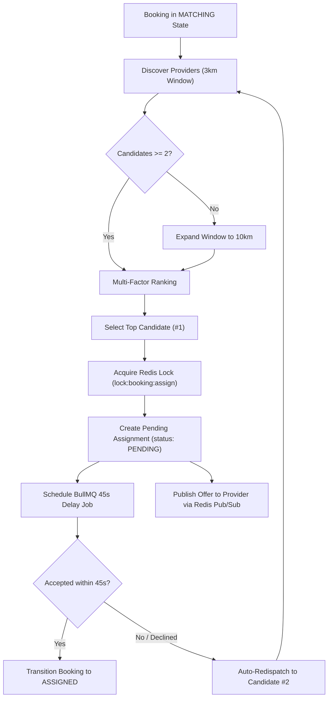

# Needs Backend — Intelligent Dispatch Engine Specification
**Version:** 1.0.0  
**Phase:** 3  

---

## 1. Overview

The Dispatch Engine matches customer service requests with qualified, verified, and available nearby service providers. The engine guarantees fairness, proximity, concurrency safety, and rapid resolution without duplicate assignments.

---

## 2. Dispatch Workflow

---

## 3. Dynamic Radius Expansion

1. **Window 1 (Standard):** 3,000 meters (3km).
2. **Expansion Threshold:** If the eligible candidate count is strictly $< 2$, the search radius dynamically expands to 10,000 meters (10km).
3. **Exclusion Tracking:** All providers previously contacted for the booking (`excludeProviderIds = booking.assignments.map(a => a.providerId)`) are filtered out to prevent repetitive offers.

---

## 4. Multi-Factor Provider Ranking

Eligible providers are ranked according to a normalized three-factor scoring model:

$$\text{Final Score} = (\text{Rating Norm} \times 0.40) + (\text{Proximity Norm} \times 0.40) + (\text{Experience Norm} \times 0.20)$$

### Factors
1. **Rating Factor (40% Weight):**
   $$\text{Rating Norm} = \frac{\text{rating}}{5.0}$$
2. **Proximity Factor (40% Weight):**
   $$\text{Proximity Norm} = \max\left(0, 1 - \frac{\text{distanceMeters}}{\text{maxRadius}}\right)$$
3. **Experience Factor (20% Weight):**
   $$\text{Experience Norm} = \frac{\min(\text{completedJobs}, 100)}{100.0}$$

Candidates are sorted descending by calculated score; the top candidate is selected for the initial dispatch offer.

---

## 5. Distributed Concurrency Lock (BR-03)

- **Lock Key:** `lock:booking:assign:{bookingId}`
- **TTL:** 10,000ms (10 seconds)
- **Mechanism:** Redis single-instance atomic lock (`SET ... NX PX`) with Lua script release.
- **Guarantee:** Prevents race conditions where two providers attempt to accept the same booking concurrently. The first provider to acquire the lock wins; subsequent requests fail with `404 NotFoundError` ("No pending assignment found").

---

## 6. 45-Second Acceptance Timer & Automated Fallback (BR-02)

1. Dispatched assignment is given `status: PENDING`.
2. A BullMQ delayed job is registered on queue `dispatch`:
   - Job Name: `dispatch-timeout`
   - Delay: `45,000` ms (45 seconds)
   - Job ID: `dispatch-timeout:{assignment.id}`
3. **Provider Acceptance:**
   - Provider calls `POST /api/v1/dispatch/bookings/:id/accept`.
   - The 45-second delayed BullMQ job is removed from the queue.
   - Assignment transitions to `ACCEPTED`. Booking transitions to `ASSIGNED`.
4. **Provider Rejection / Timeout:**
   - If the provider calls `POST /api/v1/dispatch/bookings/:id/reject`, the assignment is marked `REJECTED`.
   - If 45 seconds elapse without action, the worker processor executes `handleAssignmentTimeout`, marking the assignment `TIMEOUT`.
   - In both cases, `dispatchBooking(bookingId)` is triggered immediately to dispatch to the next best candidate.
