# NEEDS BACKEND — REQUIREMENTS TRACEABILITY MATRIX
**Document ID:** NEEDS-RTM-001  
**Author:** Senior Backend Architect & Systems Engineer  
**Date:** November 9, 2026  
**Status:** BASELINE VERIFIED  

---

## 1. Domain Module & SRS Mapping Overview

Every module corresponds to a logical service specified in SRS Section 6.1 and detailed in the project specifications.

| Module | SRS Ref / Domain | Primary Responsibilities | Data Store / Cache | Realtime / Async Infra |
|---|---|---|---|---|
| **Auth** | FR-AUTH-01..04, NFR-SEC-04 | Phone + OTP, JWT Access/Refresh rotation, session management, rate limits | PostgreSQL (`users`, `user_sessions`), Redis (OTP, token blacklist) | Redis rate-limiter, SMS queue |
| **Users** | FR-USR-01..04 | Customer profiles, address book, language preference, GDPR/account deletion | PostgreSQL (`users`, `user_addresses`) | Redis user cache |
| **Providers** | FR-PRV-01..05, BR-01 | Registration, KYC verification, status workflow (Pending/Approved/Rejected) | PostgreSQL (`providers`, `provider_kyc`, `provider_services`) | Notification events |
| **Catalog** | FR-CAT-01..03 | Categories, service taxonomy, pricing models (fixed, hourly, custom) | PostgreSQL (`categories`, `services`) | Redis catalog cache |
| **Location** | FR-MAP-01..04, NFR-PERF-01 | Provider location ingestion (5s interval), Redis GEO index, PostGIS history | Redis (`GEOADD`, `GEOSEARCH`), PostgreSQL (`provider_locations`) | Redis Pub/Sub, Location Gateway |
| **Dispatch** | FR-DSP-01..05, BR-02, BR-06 | Provider discovery, ranking, distributed lock, request timeout & auto-redispatch | Redis locks, Redis sorted sets | BullMQ `dispatch` queue, Socket dispatch event |
| **Bookings** | FR-BKG-01..06, Appendix A | Booking lifecycle, state machine, immutable `BookingEvent` ledger | PostgreSQL (`bookings`, `booking_events`, `booking_assignments`) | BullMQ `booking-expiry` queue, Tracking events |
| **Tracking** | FR-TRK-01..03, NFR-PERF-03 | Real-time provider movement, customer room broadcast, authorized telemetry | Redis Pub/Sub | Tracking Gateway (`/tracking`), Socket.IO rooms |
| **Chat** | FR-CHT-01..03 | Booking-bound customer-provider chat, message history, read receipts | PostgreSQL (`conversations`, `messages`), Redis | Chat Gateway (`/chat`), Socket.IO rooms |
| **Payments** | FR-PAY-01..07, NFR-SEC-05 | Adapters (bKash, Nagad, SSLCommerz), webhooks, idempotency, refund flow | PostgreSQL (`payments`, `payment_webhooks`) | BullMQ `payment-verification` queue |
| **Wallet** | FR-PAY-03..07, BR-09 | Double-entry ledger, customer/provider balances, payout requests | PostgreSQL (`wallets`, `wallet_transactions`, `payout_requests`) | BullMQ `payouts` queue |
| **Coupons** | FR-CPN-01..03 | Promo codes, referral rewards, usage limits, anti-abuse checks | PostgreSQL (`coupons`, `coupon_redemptions`) | Redis coupon lock |
| **Reviews** | FR-REV-01..03 | Ratings, verified-booking reviews, moderation, provider score aggregation | PostgreSQL (`reviews`) | Analytics events |
| **Notifications** | FR-NTF-01..03 | Multi-channel delivery (FCM Push, SMS fallback, In-App notification feed) | PostgreSQL (`notifications`), Firebase/SSLWireless | BullMQ `notifications` queue |
| **Support** | FR-SUP-01..03 | Support tickets, customer/provider disputes, assignment, SLA tracking, FAQs | PostgreSQL (`support_tickets`, `ticket_messages`, `faqs`) | Admin notification events |
| **Admin** | FR-ADM-01..05, NFR-SEC-06 | RBAC (SuperAdmin, Operations, Support, Finance), provider approval, audit log | PostgreSQL (`admin_users`, `roles`, `permissions`, `audit_logs`) | Audit interceptor |
| **Analytics** | FR-ANL-01..02 | Metric aggregation, revenue tracking, provider performance, ClickHouse readiness | PostgreSQL (`analytics_events`), ClickHouse client | BullMQ `analytics` queue |
| **Health** | FR-HLT-01..02 | Liveness (`/api/v1/health/liveness`), Readiness (`/api/v1/health/readiness`) | PostgreSQL probe, Redis probe, Worker probe | Continuous monitoring |

---

## 2. Business Rules (BR) Traceability

| Rule ID | Name | Constraint & Specification | Enforcement Mechanism |
|---|---|---|---|
| **BR-01** | Provider Approval Gate | Only providers in `APPROVED` status with active service profile can receive jobs. | `DispatchService.findEligibleProviders` queries `status == APPROVED` AND `isAvailable == true`. |
| **BR-02** | Dispatch Request Expiry | Dispatched job request sent to a provider expires in 45 seconds if unacknowledged. | BullMQ delayed job (`dispatch-request-expiry`) triggers redispatch if state remains unassigned. |
| **BR-03** | Single Active Assignment Lock | Two providers cannot accept the same booking. | Redis distributed lock (`lock:booking:assign:<bookingId>`) during assignment transaction. |
| **BR-04** | Immutable Event Log | Booking state changes must append an immutable `BookingEvent` entry. State can never change without an event. | PostgreSQL transaction wraps booking update and `BookingEvent` insert. Deletion disabled. |
| **BR-05** | Double-Entry Immutable Ledger | Wallet balances cannot be mutated directly. All changes must be backed by ledger transactions. | `WalletTransaction` entries with credit/debit records; balances computed or locked with row-level locks. |
| **BR-06** | Privacy Protection in Analytics | Provider KYC data, identity documents, and sensitive customer data must NEVER be used for marketing or targeted offers. | Analytics module explicitly filters out PII/KYC columns; adapter rejects schemas containing PII. |
| **BR-07** | Verified Booking Reviews | Only customers who completed a booking can rate and review the associated provider. | `ReviewsService.createReview` verifies `booking.customerId == currentUserId` AND `booking.status == COMPLETED`. |
| **BR-08** | OTP Security & Abuse Protection | OTP code valid for exactly 5 minutes (300s); max 3 resend attempts per hour; max 5 failed verify attempts. | Redis key with TTL + rate limit counters (`otp:resend:<phone>`, `otp:attempts:<phone>`). |
| **BR-09** | Strict Payment Verification | Client-side payment confirmation is completely untrusted. Only verified gateway callbacks/webhooks confirm payment. | Webhook HMAC verification + direct server-to-server gateway query before updating booking to `PAID`. |

---

## 3. Non-Functional Requirements (NFR) Traceability

| NFR ID | Category | Target Metric | Backend Implementation Strategy |
|---|---|---|---|
| **NFR-PERF-01** | Location Ingestion | < 100ms processing time for 5s provider telemetry | Ingest via lightweight Socket.IO gateway directly into Redis `GEOADD` with ephemeral keys. |
| **NFR-PERF-03** | Dispatch Notification | Dispatch notification delivered to provider < 2s | Redis GEO query -> candidate filter -> Socket.IO room emit with acknowledgment packet. |
| **NFR-SEC-04** | Authentication Security | Dual-token rotation, bcrypt salt 12, rate-limiting | 15m Access JWT, 7d Refresh JWT with family revocation in Redis, IP-based login rate limiting. |
| **NFR-SEC-05** | Payment Integrity | Zero fraud, no duplicate processing | Idempotency key table (`idempotency_keys`), HMAC-SHA256 signature check for all webhooks. |
| **NFR-SEC-06** | RBAC & Auditability | Complete attribution of administrative actions | Granular permissions table, `AdminAuditInterceptor` logging actor, IP, timestamp, and diff. |
| **NFR-REL-04** | Transaction Consistency | Zero orphaned records on failure | Prisma interactive transactions (`prisma.$transaction`) for all multi-step financial and lifecycle actions. |
| **NFR-SCL-04** | Realtime Horizontal Scale | Seamless multi-instance socket coordination | Socket.IO Redis Adapter (`@socket.io/redis-adapter`) enabling stateless socket servers. |

---

## 4. Appendix A: Booking Lifecycle & State Machine

```mermaid
stateDiagram-v2
    [*] --> DRAFT: Customer configures service
    DRAFT --> REQUESTED: Customer confirms & submits
    REQUESTED --> MATCHING: Dispatch engine triggered
    MATCHING --> ASSIGNED: Provider accepts job
    MATCHING --> EXPIRED: No provider accepted in timeout
    ASSIGNED --> PROVIDER_EN_ROUTE: Provider departs for location
    PROVIDER_EN_ROUTE --> PROVIDER_ARRIVED: Provider reaches customer
    PROVIDER_ARRIVED --> IN_PROGRESS: OTP / Work started
    IN_PROGRESS --> COMPLETED: Provider finishes & Customer confirms
    
    REQUESTED --> CANCELLED: Customer cancels before match
    MATCHING --> CANCELLED: Customer cancels during search
    ASSIGNED --> CANCELLED: Customer / Provider cancels (with policy)
    PROVIDER_EN_ROUTE --> CANCELLED: Late cancellation (fee applies)
    
    EXPIRED --> [*]
    COMPLETED --> [*]
    CANCELLED --> [*]
```

### Transition Validation Matrix

| From Status | To Status | Triggered By | Allowed Conditions / Guards | Side Effects / Events Emitted |
|---|---|---|---|---|
| `DRAFT` | `REQUESTED` | Customer | Address and valid service specified | `BookingRequestedEvent`, push to Dispatch queue |
| `REQUESTED` | `MATCHING` | System | Dispatch queue picks up job | `BookingMatchingEvent`, Redis GEO provider search |
| `MATCHING` | `ASSIGNED` | Provider | First provider to accept with acquired lock | `BookingAssignedEvent`, notify customer, cancel competitor offers |
| `MATCHING` | `EXPIRED` | System (Worker) | Dispatch retry count exceeded or timeout | `BookingExpiredEvent`, notify customer, prompt retry |
| `ASSIGNED` | `PROVIDER_EN_ROUTE` | Provider | Provider taps "On My Way" | `ProviderEnRouteEvent`, start live tracking room |
| `ASSIGNED` | `CANCELLED` | Customer/Provider | Cancellation window open | `BookingCancelledEvent`, release lock, notify parties |
| `PROVIDER_EN_ROUTE` | `PROVIDER_ARRIVED`| Provider | Proximity check / Provider tap | `ProviderArrivedEvent`, notify customer |
| `PROVIDER_ARRIVED` | `IN_PROGRESS` | Provider | Customer provides Start OTP | `BookingStartedEvent`, start service timer |
| `IN_PROGRESS` | `COMPLETED` | Provider/Customer | End OTP or customer confirmation | `BookingCompletedEvent`, create payment invoice, trigger wallet credit |
| `*` (Any active) | `CANCELLED` | Customer/Admin | Valid cancellation reason | `BookingCancelledEvent`, process refunds if paid |

---

## 5. API Endpoint Inventory (Target)

| Endpoint | Method | Role | Description |
|---|---|---|---|
| `/api/v1/auth/otp/send` | POST | Public | Request OTP for login/registration |
| `/api/v1/auth/otp/verify` | POST | Public | Verify OTP and issue JWT access + refresh tokens |
| `/api/v1/auth/token/refresh` | POST | Public | Rotate refresh token and issue new access token |
| `/api/v1/auth/logout` | POST | Authenticated | Revoke refresh token and invalidate session |
| `/api/v1/users/profile` | GET, PATCH | Customer | Get/update user profile |
| `/api/v1/users/addresses` | GET, POST, DELETE | Customer | Manage customer address book |
| `/api/v1/providers/profile` | GET, PATCH | Provider | Provider profile details and online status |
| `/api/v1/providers/kyc` | GET, POST | Provider | Submit KYC documents (NID, trade license) |
| `/api/v1/catalog/categories` | GET, POST | Public / Admin | List or create service categories |
| `/api/v1/catalog/services` | GET, POST | Public / Admin | List or create service offerings |
| `/api/v1/location/update` | POST | Provider | Ingest provider GPS coordinate |
| `/api/v1/location/nearby` | GET | Authenticated | Query nearby active providers via PostGIS / Redis GEO |
| `/api/v1/dispatch/accept` | POST | Provider | Accept a dispatched job offer |
| `/api/v1/dispatch/reject` | POST | Provider | Decline a dispatched job offer |
| `/api/v1/bookings` | GET, POST | Customer | List or create bookings |
| `/api/v1/bookings/[id]` | GET | Customer/Provider/Admin | Get detailed booking state and event history |
| `/api/v1/bookings/[id]/status` | PATCH | Customer/Provider | Transition booking state with OTP or verification |
| `/api/v1/payments/initiate` | POST | Customer | Initiate bKash/Nagad/SSLCommerz payment |
| `/api/v1/payments/webhook/[gateway]`| POST | Public (Webhook) | Secure HMAC verified payment webhook handler |
| `/api/v1/wallet` | GET | Customer/Provider | Fetch current balance and ledger transactions |
| `/api/v1/wallet/payout` | POST | Provider | Request withdrawal to mobile money / bank |
| `/api/v1/coupons/validate` | POST | Customer | Check coupon eligibility and calculate discount |
| `/api/v1/reviews` | POST, GET | Customer | Submit review for completed booking |
| `/api/v1/notifications` | GET, PATCH | Authenticated | In-app notification list and mark-as-read |
| `/api/v1/support/tickets` | GET, POST | Authenticated | Create or list customer/provider support tickets |
| `/api/v1/admin/providers/verify` | POST | Admin (Ops) | Approve or reject provider KYC |
| `/api/v1/admin/audit-logs` | GET | Admin (Super) | Retrieve immutable audit log records |
| `/api/v1/health/liveness` | GET | Public | Container liveness probe |
| `/api/v1/health/readiness` | GET | Public | Container readiness probe (PostgreSQL + Redis + Worker) |
