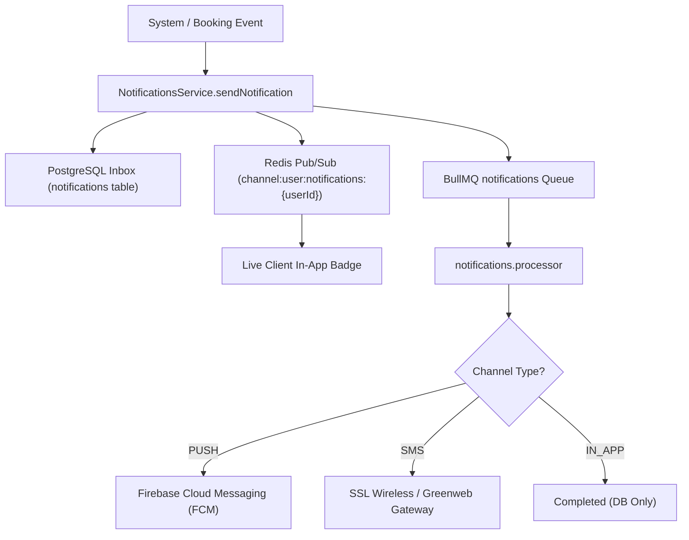

# Needs Backend — Multi-Channel Notifications Engine Specification
**Version:** 1.0.0  
**Phase:** 4  

---

## 1. Overview

The Needs notification engine orchestrates cross-channel notifications across mobile, web, and SMS. The engine guarantees delivery through local database persistence, real-time WebSocket pushes, background task workers, and exponential backoff retries.

---

## 2. Multi-Channel Routing Architecture

---

## 3. Channels

1. **`IN_APP`:**
   - Every notification is stored in the PostgreSQL `notifications` table.
   - Provides users with an inbox/feed (`GET /api/v1/notifications`).
   - Fields: `id`, `userId`, `title`, `body`, `channel`, `data` (JSON metadata), `isRead`, `createdAt`.
   - Supports mark-as-read for individual notifications and batch mark-all-read.
2. **`PUSH`:**
   - Dispatched to mobile devices via Firebase Cloud Messaging (FCM) tokens.
   - Used for time-sensitive alerts: provider arrival, chat messages, payment confirmation, promo offers.
3. **`SMS`:**
   - Fallback delivery channel integrated with licensed Bangladeshi SMS aggregators (e.g., SSL Wireless).
   - Used for critical alerts: OTPs, booking assignment updates, emergency cancellations.

---

## 4. Background Job Queue (`notifications`)

- Background processing decouples slow external HTTP requests (FCM, SMS aggregators) from the primary API request loop.
- **Queue Name:** `notifications`
- **Retry Policy:**
  - `attempts: 3`
  - `backoff: { type: 'exponential', delay: 2000 }` (Retries after 2s, 4s, 8s on failure)
- **Concurrency:** Configured to process 10 concurrent notification jobs in `workers/index.ts`.

---

## 5. REST API Endpoints

- `GET /api/v1/notifications`: Paginated in-app notification list for authenticated user with unread counter.
- `PATCH /api/v1/notifications/:id/read`: Mark an individual notification as read.
- `POST` / `PATCH /api/v1/notifications/read-all`: Mark all notifications as read for current user.
