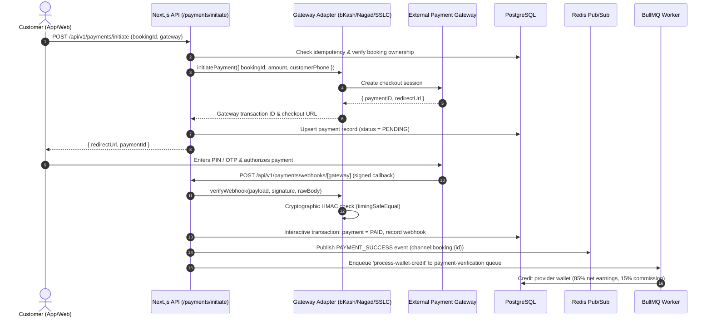
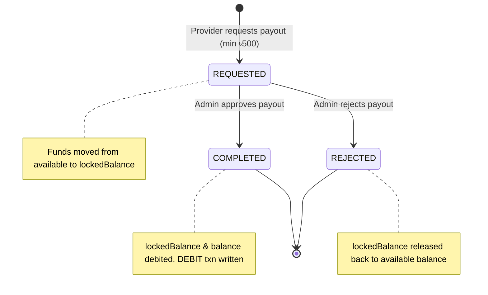

# Needs Backend — Payments & Double-Entry Wallet Architecture
**Version:** 1.0.0  
**Phase:** 5  

---

## 1. Executive Summary

The Needs financial architecture provides a zero-loss, audit-compliant, double-entry financial platform tailored for Bangladesh's payments ecosystem. It features:
1. Direct integration with Bangladesh's top 3 payment gateways: **bKash**, **Nagad**, and **SSLCommerz**.
2. Strict **HMAC-SHA256 / MD5 signature verification** and **timing-safe comparison** on all webhook callbacks.
3. PostgreSQL **Idempotency Key engine** (`idempotency_keys`) preventing duplicate charges or replays.
4. An immutable **Double-Entry Wallet & Ledger** (`wallets`, `wallet_transactions`) with strict balance locking and non-negative constraints.
5. Automated **15% platform commission** and **85% provider net earnings** crediting upon booking completion.
6. A multi-stage **Payout Lifecycle** with fund reservation (`lockedBalance`), 500 BDT minimum threshold, and admin review workflows.

---

## 2. Payment Gateway Architecture

---

## 3. Supported Bangladeshi Gateways & Cryptographic Verification

| Gateway | Supported Methods | Checkout Session Endpoint | Verification Protocol | Timing-Safe Comparison |
| :--- | :--- | :--- | :--- | :--- |
| **bKash** | Tokenized Checkout, bKash App, USSD | `/checkout?paymentID={id}` | HMAC-SHA256 signature using `BKASH_APP_SECRET` | `crypto.timingSafeEqual` |
| **Nagad** | Direct Pay, Nagad App | `/check-out/{id}?merchant={id}` | HMAC-SHA256 with Merchant Key / Public Key | `crypto.timingSafeEqual` |
| **SSLCommerz** | Cards, Net Banking, All MFS, EMI | `/gwprocess/v4/checkout?session={id}` | MD5 checksum with `SSLCOMMERZ_STORE_PASSWORD` | `crypto.timingSafeEqual` |

### Webhook Security & Idempotency Rules (BR-09 & NFR-SEC-05)
1. **Client Untrusted:** Client-side redirects or success pages are never trusted. Payment is marked `PAID` exclusively when a cryptographically verified webhook arrives.
2. **Raw Body Integrity:** Webhooks verify signatures against the raw unparsed request body to eliminate JSON serialization differences.
3. **Idempotency Keys:** Duplicate webhook calls with the same `gatewayTransactionId` are detected, returning `{ received: true, processed: true }` without re-crediting provider wallets.

---

## 4. Double-Entry Wallet & Ledger (`wallets`, `wallet_transactions`)

### 4.1 Invariants & Non-Negative Balance Protection (BR-05)
- All mutations run within `prisma.$transaction`.
- At no point can `balance` or `availableBalance` drop below zero.
- `availableBalance = wallet.balance - wallet.lockedBalance`.
- Every change to a balance appends an immutable `WalletTransaction` row (`CREDIT` or `DEBIT`) with `balanceAfter` snapshot.
- Historical `wallet_transactions` records cannot be updated or deleted.

### 4.2 Automated Commission & Provider Earnings
Upon verified customer payment for completed booking:
$$\text{Platform Commission} = 0.15 \times \text{Total Amount}$$
$$\text{Provider Net Credit} = 0.85 \times \text{Total Amount}$$

Example:
- Total Customer Bill: ৳1,000.00
- Platform Fee: ৳150.00
- Provider Earning: ৳850.00 credited with ledger reason `PROVIDER_EARNING`.

---

## 5. Payout Lifecycle & Fund Reservation

1. **Request:** Provider requests payout (`POST /api/v1/wallet/payouts`).
   - Checks available balance: $\ge \text{amount}$.
   - Minimum threshold: ৳500.00.
   - The requested amount is added to `lockedBalance` so it cannot be spent or double-withdrawn.
2. **Review:** Admin / Finance retrieves pending requests (`GET /api/v1/admin/payouts`).
3. **Approval (`COMPLETED`):**
   - Admin approves (`PATCH /api/v1/admin/payouts/:id` with `{ status: 'COMPLETED' }`).
   - `lockedBalance` and `balance` are decremented.
   - An immutable `DEBIT` transaction with reason `WITHDRAWAL` is recorded.
4. **Rejection (`REJECTED`):**
   - Admin rejects (`PATCH /api/v1/admin/payouts/:id` with `{ status: 'REJECTED', rejectionReason: '...' }`).
   - `lockedBalance` is decremented back to 0, immediately unlocking the funds for provider use.

---

## 6. Endpoints Summary

| Endpoint | Method | Role | Description |
| :--- | :--- | :--- | :--- |
| `/api/v1/payments/initiate` | `POST` | `CUSTOMER` | Initiate gateway checkout session |
| `/api/v1/payments/webhooks/:gateway` | `POST` | Public | Receive & verify signed payment notification |
| `/api/v1/payments/booking/:id` | `GET` | Authenticated | View payment status for a booking |
| `/api/v1/wallet/balance` | `GET` | Authenticated | Get current balance, locked balance, and available balance |
| `/api/v1/wallet/transactions` | `GET` | Authenticated | Get paginated double-entry ledger history |
| `/api/v1/wallet/topup` | `POST` | Authenticated | Credit wallet balance |
| `/api/v1/wallet/payouts` | `POST` | `PROVIDER` | Request withdrawal (minimum ৳500) |
| `/api/v1/wallet/payouts` | `GET` | `PROVIDER` | View provider's own payout request history |
| `/api/v1/admin/payouts` | `GET` | `ADMIN`, `FINANCE` | List all provider payout requests |
| `/api/v1/admin/payouts/:id` | `PATCH` | `ADMIN`, `FINANCE` | Approve (`COMPLETED`) or reject (`REJECTED`) payout |
