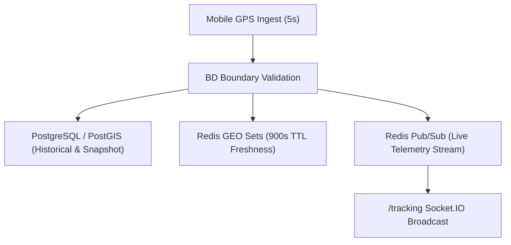

# Needs Backend — Spatial Logistics & Real-Time Telemetry Specification
**Version:** 1.0.0  
**Phase:** 3  

---

## 1. Overview

The Needs platform processes high-frequency geospatial coordinate streams from active service providers across Bangladesh. The spatial pipeline is optimized for sub-second location ingestion, low-latency proximity queries, and high-precision spatial filtering.

---

## 2. Ingestion Pipeline & Coordinate Normalization

Provider mobile applications emit telemetry updates via `POST /api/v1/location/providers/current` on a 5-second interval while online.

### Validated Fields
- `latitude`: Must fall within the Bangladesh national latitude boundary (`20.5` to `26.7`).
- `longitude`: Must fall within the Bangladesh national longitude boundary (`88.0` to `92.7`).
- `city`: Standard administrative division (default: `"Dhaka"`).
- `heading`: Heading in degrees (`0` to `360`).
- `speed`: Speed in meters per second ($\ge 0$).
- `accuracy`: Horizontal GPS accuracy radius in meters ($\ge 0$).

---

## 3. Storage Hierarchy



### 3.1 Redis Geospatial Indexing
- Commands: `GEOADD`, `GEOSEARCH`
- Partitioning: Keys are partitioned by city and service category to maintain compact sorted sets:
  - `geo:providers:{city}:all`
  - `geo:providers:{city}:{categoryId}`
- Member Format: `providerId` (UUID)
- Coordinate Order: `longitude, latitude` (Strict GeoJSON and Redis standard)
- TTL: 15 minutes (`900s`). Stale coordinates automatically expire if the provider goes offline or loses connectivity.

### 3.2 PostGIS Spatial Fallback & Snapshot
- Model: `providers.currentLatitude`, `providers.currentLongitude`, `providers.lastLocationUpdate`
- Spatial Column Expression: `ST_SetSRID(ST_MakePoint("currentLongitude", "currentLatitude"), 4326)::geography`
- GiST Spatial Index: Indexed using `USING GIST (...)` for fast bounding-box and distance computations.
- Query Functions:
  - `ST_DWithin(geom, ST_SetSRID(ST_MakePoint(lon, lat), 4326)::geography, radiusMeters)`
  - `ST_DistanceSphere(geom, ST_SetSRID(ST_MakePoint(lon, lat), 4326))`

---

## 4. Telemetry Event Stream

Whenever a provider location is updated, a telemetry packet is published to Redis channel `channel:provider:location:{providerId}`:

```json
{
  "providerId": "e5c6a1b2-...",
  "latitude": 23.7501,
  "longitude": 90.3804,
  "city": "Dhaka",
  "heading": 90,
  "speed": 28.5,
  "accuracy": 4.2,
  "timestamp": "2026-11-10T02:58:00.000Z"
}
```

The WebSocket `/tracking` gateway subscribes to this channel and multiplexes updates directly into the active booking's room (`booking:{bookingId}`).
